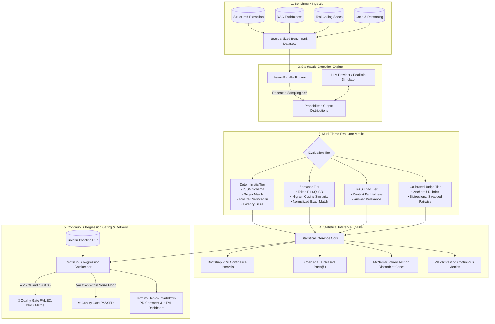

# ProbEval: Automated LLM Evaluation Suites & Continuous Regression Testing

[](https://www.python.org/downloads/)
[](LICENSE)
[](.github/workflows/llm_eval_regression.yml)
[](https://github.com/astral-sh/ruff)
[](#multi-tiered-evaluator-matrix)

> **A production-grade framework for automated benchmarking, probabilistic evaluation, and continuous statistical regression testing for non-deterministic Large Language Model systems.**

---

## 🌟 Why ProbEval?

Evaluating generative AI models is fundamentally different from evaluating classical software:

1. **Non-Determinism & Sampling Jitter**: Even at `temperature=0`, floating-point arithmetic across GPU tensor cores, dynamic batching, and mixture-of-experts (MoE) token routing cause output variance. A single-shot assertion (`assert response == expected`) is statistically meaningless.
2. **The "Silent Regression" Crisis**: An engineer tweaks a system prompt or model checkpoint to fix an edge case, inadvertently degrading structured JSON compliance or safety guardrails by 8% across existing workloads.
3. **Flaky Evaluations vs. Real Degradation**: Without statistical hypothesis testing, teams cannot differentiate between **expected random sampling noise** and **statistically significant regressions**, leading to noisy CI pipelines or degraded production deployments.
4. **Judge Cognitive Biases**: LLM-as-a-judge evaluators suffer from severe **Position Bias** (favoring Option A by 10–20%), **Length Bias** (favoring verbosity), and **Self-Enhancement Bias**.

`ProbEval` provides the mathematical foundation, execution pipeline, and CI/CD quality gates required to reliably deploy generative AI systems into production.

---

## 🏗️ System Architecture



---

## 🔬 Mathematical & Statistical Foundations

`ProbEval` replaces naive assertions with formal statistical hypothesis testing:

### 1. Non-Parametric Bootstrap Resampling (95% Confidence Intervals)
Standard Gaussian assumptions ($\mu \pm 1.96 \frac{\sigma}{\sqrt{N}}$) fail for bounded $[0, 1]$ evaluation metrics. `ProbEval` draws $B = 1,500$ replicates with replacement from the empirical data distribution:
$$\text{CI}_{\text{lower}} = \hat{\theta}^{*\left(\left\lfloor \frac{\alpha}{2} B \right\rfloor\right)}, \quad \text{CI}_{\text{upper}} = \hat{\theta}^{*\left(\left\lceil \left(1 - \frac{\alpha}{2}\right) B \right\rceil\right)}$$

### 2. Unbiased Pass@k Estimation (Chen et al. 2021)
Evaluates generative multi-sample yield across $n$ samples with budget $k$:
$$\text{pass@}k = 1 - \prod_{i=1}^k \frac{n - c - i + 1}{n - i + 1}$$
where $n$ is total samples and $c$ is passing samples.

### 3. McNemar's Paired Test for Categorical Regressions
When comparing candidate prompts against a golden baseline on identical test cases, independent tests lose statistical power. `ProbEval` isolates **discordant pairs** (regressions $b$ vs improvements $c$):
$$\chi^2 = \frac{(|b - c| - 1)^2}{b + c}$$
*(Uses exact two-sided binomial testing when $b + c < 25$).*

### 4. LLM Judge Position Bias Mitigation
Pairs are evaluated across **bidirectional swaps**:
- **Trial 1**: Option A = Candidate, Option B = Baseline
- **Trial 2**: Option A = Baseline, Option B = Candidate
- *Candidate is declared winner only if it defeats baseline in both orientations. If Option A is picked in both trials, position bias is flagged and discounted.*

---

## ⚡ Quickstart

### 1. Installation
Clone the repository and install dependencies in editable mode:
```bash
git clone https://github.com/subasah/probabilistic-llm-eval-suite.git
cd probabilistic-llm-eval-suite
pip install -e ".[dev]"
```

### 2. Run the Interactive Scenarios
`ProbEval` includes zero-cost, reproducible scenarios powered by its built-in realistic LLM simulator (or live OpenAI/Anthropic/Gemini APIs):

```bash
# Scenario 1: Detect subtle prompt regressions using McNemar's test
make demo
# or: python examples/01_prompt_regression_test.py

# Scenario 2: Benchmark legacy enterprise model vs high-speed candidate model
make migration
# or: python examples/02_model_migration_benchmark.py

# Scenario 3: Measure Pass@k across sampling temperatures (0.0 vs 0.4 vs 0.8)
make passk
# or: python examples/03_probabilistic_pass_at_k.py

# Scenario 4: Mitigate LLM judge position bias with bidirectional swapping
make bias
# or: python examples/04_llm_judge_bias_mitigation.py
```

### 3. Run Unit & Statistical Tests
```bash
make test
# or: pytest -v tests/
```

---

## 🖥️ Command-Line Interface (CLI)

`ProbEval` includes a rich CLI for automated testing and CI/CD pipelines:

### Run an Evaluation Benchmark
```bash
probeval run --benchmark structured_extraction --samples 5 --temperature 0.2
```
*Outputs Rich terminal tables and compiles an interactive HTML dashboard at `reports/eval_report.html`.*

### Compare Candidate vs. Golden Baseline
```bash
probeval compare \
  --benchmark structured_extraction \
  --regression-factor 0.12 \
  --samples 6 \
  --html reports/regression_report.html
```

---

## 📊 Interactive HTML Dashboard

Every evaluation run compiles into a standalone, interactive HTML dashboard featuring:
- Glassmorphism dark-mode UI with Tailwind CSS
- KPI Metric Cards with Bootstrap 95% Confidence Interval error bands
- Pass@1, Pass@3, and Pass@k yield metrics
- Continuous Regression Gate table with p-values and significance verdicts
- Interactive Test Case Explorer: Click any prompt to inspect raw completions, latencies, and evaluator scores across all probabilistic trials.

*(Saved automatically to `reports/eval_report.html` or viewable offline).*

---

## 🔄 CI/CD Regression Gate Integration

`ProbEval` is configured for continuous integration via GitHub Actions (`.github/workflows/llm_eval_regression.yml`):

```yaml
- name: Run Continuous Regression Quality Gate
  run: |
    python -m probeval.cli compare \
      --benchmark structured_extraction \
      --regression-factor 0.05 \
      --samples 6 \
      --html reports/ci_regression_report.html
```

### Automated PR Markdown Reporting
When a pull request triggers the regression gate, `ProbEval` generates a structured markdown summary:

| Metric | Baseline | Candidate | Delta (Δ) | p-value | Significant? | Status |
| :--- | :---: | :---: | :---: | :---: | :---: | :---: |
| `overall_pass_rate` | 0.960 | 0.800 | -0.160 (-16.7%) | 0.0082 | **YES** | 🔴 **FAIL** |
| `json_schema_valid` | 0.980 | 0.820 | -0.160 (-16.3%) | 0.0041 | **YES** | 🔴 **FAIL** |
| `latency_sla` | 0.973 | 0.973 | +0.000 (+0.0%) | 0.8500 | No (noise) | 🟢 **PASS** |

---

## 📚 Deep-Dive Documentation

Explore comprehensive guides in the [`docs/`](docs/) directory:

- 🏛️ [**System Architecture & Technical Design**](docs/ARCHITECTURE.md) - Component lifecycle and multi-tiered evaluation flow.
- 📐 [**Statistical Foundations & Mathematics**](docs/STATISTICAL_FOUNDATIONS.md) - Bootstrap resampling, Pass@k derivation, Wilson intervals, and McNemar testing.
- ⚖️ [**LLM-as-a-Judge Calibration & Bias Mitigation**](docs/LLM_AS_A_JUDGE_CALIBRATION.md) - Eliminating position, length, and self-enhancement biases.
- 🛡️ [**Continuous Regression Testing in CI/CD**](docs/CONTINUOUS_REGRESSION_TESTING.md) - Quality gates, golden baselines, and production triage.
- 🎯 [**Recruiter & Technical Interview Cheat Sheet**](docs/RECRUITER_INTERVIEW_CHEATSHEET.md) - High-impact interview Q&A, elevator pitches, and system design topics.

---

## 🤝 Project Structure

```text
probabilistic-llm-eval-suite/
├── .github/workflows/
│   ├── llm_eval_regression.yml    # CI workflow for regression gating
│   └── test_suite.yml             # Matrix test suite across Python versions
├── benchmarks/                    # Benchmark datasets (JSONL)
│   ├── structured_extraction.jsonl
│   ├── rag_faithfulness.jsonl
│   ├── code_and_reasoning.jsonl
│   └── tool_calling.jsonl
├── docs/                          # Architecture, math, and interview guides
│   ├── ARCHITECTURE.md
│   ├── STATISTICAL_FOUNDATIONS.md
│   ├── LLM_AS_A_JUDGE_CALIBRATION.md
│   ├── CONTINUOUS_REGRESSION_TESTING.md
│   └── RECRUITER_INTERVIEW_CHEATSHEET.md
├── examples/                      # Runnable production scenarios
│   ├── 01_prompt_regression_test.py
│   ├── 02_model_migration_benchmark.py
│   ├── 03_probabilistic_pass_at_k.py
│   └── 04_llm_judge_bias_mitigation.py
├── src/probeval/                  # Core package
│   ├── cli.py                     # Typer CLI application
│   ├── config.py                  # Pydantic schemas & data models
│   ├── models/                    # Model providers & simulator
│   ├── evaluators/                # Deterministic, semantic, and judge evaluators
│   ├── statistics/                # Bootstrap, Pass@k, McNemar, regression gate
│   ├── runner/                    # Async parallel execution engine
│   └── reporting/                 # Console, HTML, and GitHub PR reporters
├── tests/                         # Pytest test suite (15 unit tests)
├── Makefile                       # Developer command shortcuts
├── pyproject.toml                 # Modern package configuration
└── LICENSE                        # MIT License
```

---

## 👤 Author & Contact

**Subash Adhikari**  
GitHub: [@subasah](https://github.com/subasah)  
Repository: [probabilistic-llm-eval-suite](https://github.com/subasah/probabilistic-llm-eval-suite)

---

## 📄 License

This project is licensed under the MIT License - see the [LICENSE](LICENSE) file for details.
