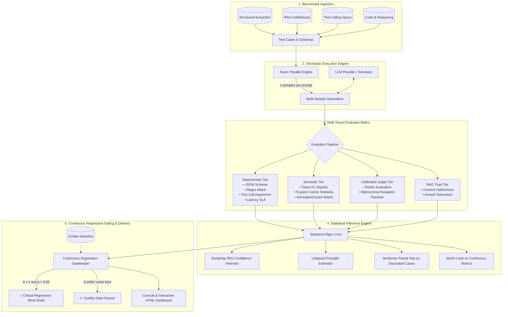
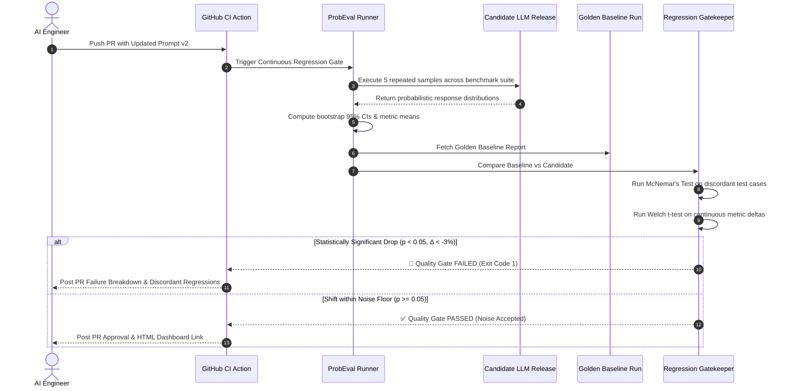

# System Architecture & Technical Design

`ProbEval` is a production-grade framework designed to solve the central challenge of LLM quality engineering: **evaluating and regression-testing probabilistic, non-deterministic model outputs with statistical rigor.**

---

## 1. High-Level Architectural Flow

The architecture operates across five distinct phases:
1. **Benchmark Specification**: Ingestion of test suites (structured JSON, RAG contexts, tool schemas, reasoning prompts).
2. **Stochastic Sampling & Execution Engine**: Asynchronous concurrent generation of repeated samples ($n$ trials per prompt) across temperature curves.
3. **Multi-Tiered Evaluation Matrix**: Fast-path deterministic checks, semantic embeddings, and calibrated LLM judges.
4. **Statistical Inference Engine**: Bootstrap resampling, Pass@k estimation, and McNemar hypothesis testing.
5. **Continuous Quality Gate & Reporting**: CI/CD regression gating, terminal summaries, and interactive HTML dashboards.

---

## 2. Component Breakdown

### 2.1 Model Provider Abstraction (`src/probeval/models/`)
- **`BaseModelProvider`**: Protocol specifying `generate_async()` and `generate()`, returning unified `ModelResponse` with normalized text, token counts, latency, and tool calls.
- **`SimulatedLLMProvider`**: Zero-cost, reproducible LLM simulator that exhibits authentic probabilistic non-determinism, controllable temperature noise, and parameterized regression injection.
- **`OpenAIProvider` & `ModelFactory`**: Direct support for OpenAI, Anthropic, Gemini, or any OpenAI-compatible endpoint (Ollama, vLLM, OpenRouter).

### 2.2 Multi-Tiered Evaluators (`src/probeval/evaluators/`)
Evaluating generative outputs with a single metric produces blind spots. `ProbEval` organizes evaluators into tiered costs and guarantees:

| Tier | Evaluator | Typical Latency | Cost | Failure Mode Caught |
| :--- | :--- | :--- | :--- | :--- |
| **Tier 1: Deterministic** | `JsonSchemaEvaluator` | < 1 ms | $0 | Syntax errors, missing required keys, schema violations |
| **Tier 1: Deterministic** | `ToolCallEvaluator` | < 1 ms | $0 | Hallucinated function names, invalid parameter JSON |
| **Tier 1: Deterministic** | `RegexEvaluator` | < 1 ms | $0 | Banned toxic phrases, missing mandatory terms |
| **Tier 1: Deterministic** | `LatencyBudgetEvaluator`| < 0.1 ms | $0 | SLA latency spikes and inference degradation |
| **Tier 2: Semantic** | `TokenF1Evaluator` | < 2 ms | $0 | Paraphrasing quality, token overlap precision/recall |
| **Tier 2: Semantic** | `CosineSimilarityEvaluator`| < 5 ms | $0 | Semantic drift, vector proximity |
| **Tier 3: RAG Triad** | `FaithfulnessEvaluator` | < 5 ms | $0 | Hallucinated claims unsupported by retrieved context |
| **Tier 3: RAG Triad** | `AnswerRelevanceEvaluator`| < 5 ms | $0 | Dodging questions, conversational off-topic drift |
| **Tier 4: Model Judge** | `CalibratedRubricJudge` | ~500 ms | API Cost | Nuanced reasoning, adherence to complex guidelines |
| **Tier 4: Model Judge** | `PairwiseJudge` (Swapped)| ~1000 ms | API Cost | Head-to-head model ranking with position bias mitigation |

---

## 3. The Continuous Regression Lifecycle

In classical CI/CD, a test is binary (`assert result == expected`). In LLMOps, prompt changes, temperature sampling, and model weight updates introduce **stochastic output variation**.

---

## 4. Key Design Principles

1. **Deterministic Reproducibility**: The evaluation harness supports fixed random seeds for both simulator sampling and bootstrap resamples, enabling deterministic debugging of stochastic systems.
2. **Zero-Lockin Architecture**: Core statistical engines and deterministic evaluators have zero external cloud dependencies.
3. **Fail-Fast Gating**: Critical evaluators (e.g., schema validation) can be designated as blocking, immediately flagging regressions before downstream steps run.
4. **Observable Artifacts**: Evaluation reports are compiled into standalone HTML files with inline data, ensuring they can be viewed offline, attached to GitHub Actions, or embedded in internal engineering portals.
