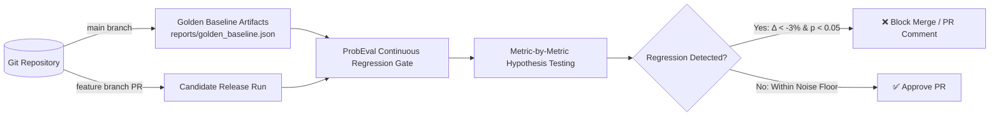

# Continuous Regression Testing for Probabilistic LLM Systems

In enterprise software engineering, code changes are protected by automated CI/CD unit and integration tests. When transitioning to LLM-powered applications, traditional CI/CD pipelines break down:
1. **Flaky builds**: If tests assert hardcoded strings, non-deterministic generation causes builds to fail intermittently without any code bugs.
2. **Silent regressions**: Developers loosen tests to avoid flakes (e.g. `assert len(response) > 0`), allowing severe hallucinations or schema regressions to slip into production unnoticed.

`ProbEval` introduces **Continuous Statistical Regression Testing** as a first-class citizen of LLMOps pipelines.

---

## 1. The Golden Baseline Methodology

Never evaluate a pull request in isolation. An isolated run score of 88% tells you nothing about whether the branch is an upgrade or a regression.

`ProbEval` compares every Pull Request against a version-controlled **Golden Baseline Run**:



### Baseline Management Rules:
- A golden baseline is generated by running the benchmark suite with fixed seeds and $n \ge 5$ samples across all core tasks on `main`.
- When an intentional architectural upgrade is deployed (e.g. migrating from GPT-4o-mini to Claude-3.5-Haiku), the golden baseline is re-anchored via an explicit, approved workflow dispatch.

---

## 2. Statistical Noise Floor vs. Real Regression

When comparing a candidate run against the baseline, every metric shift falls into one of three categories:

| Scenario | Delta ($\Delta$) | p-value | Interpretation | CI/CD Action |
| :--- | :---: | :---: | :--- | :--- |
| **Statistical Noise** | $-1.5\%$ | $p = 0.42$ | Variation is within expected sampling noise floor. | **PASS** (Do not block build) |
| **Acceptable Degradation** | $-0.5\%$ | $p = 0.04$ | Statistically significant but below practical effect size threshold ($\epsilon = 3\%$). | **WARN** (Log warning) |
| **Critical Regression** | $-7.2\%$ | $p = 0.008$ | True degradation exceeding both significance and effect size thresholds. | **FAIL** (Block merge immediately) |

### The Gatekeeper Decision Formula:
A regression is flagged if and only if:
$$\Delta = \mu_{\text{candidate}} - \mu_{\text{baseline}} < -\epsilon \quad \text{AND} \quad p\text{-value} < \alpha$$

where:
- $\epsilon$: Minimum practical effect size threshold (default $\epsilon = 0.03$ or 3%)
- $\alpha$: Significance level (default $\alpha = 0.05$)
- $p\text{-value}$: Derived from McNemar's paired test (for binary pass rates) or Welch's t-test (for continuous scores).

---

## 3. GitHub Actions CI/CD Integration

`ProbEval` integrates into GitHub Actions via `.github/workflows/llm_eval_regression.yml`.

### Example CI Step:
```bash
python -m probeval.cli compare \
  --benchmark structured_extraction \
  --regression-factor 0.05 \
  --samples 6 \
  --html reports/ci_regression_report.html
```

When a regression is detected, `ProbEval` outputs an automated, rich Markdown summary directly to the Pull Request.

---

## 4. Regression Triage Playbook

When the CI gate fails:
1. **Inspect Discordant Pairs**: Check the McNemar contingency table to identify the specific test cases that transitioned from `Baseline Pass` to `Candidate Fail`.
2. **Analyze Output Diff**: Open the interactive HTML report and expand the failing test case to examine the raw generated completions across all $n$ trials.
3. **Determine Cause**:
   - *Prompt Drift*: Did a system prompt adjustment for edge case X degrade formatting on edge case Y?
   - *Token Truncation*: Did max token limits cut off the response prematurely?
   - *Model Deprecation / Provider Drift*: Did the underlying model provider release a silent checkpoint update?
