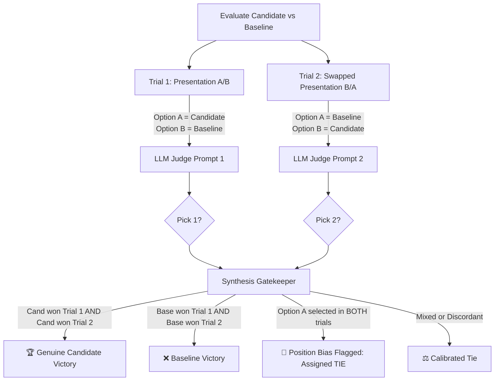

# LLM-as-a-Judge Calibration & Bias Mitigation

Using an LLM to evaluate other LLMs (LLM-as-a-Judge) has become an industry standard, but naive implementations are plagued by severe systematic cognitive biases. This document explains how `ProbEval` identifies and eliminates these distortions.

---

## 1. The Four Systematic Biases in LLM Judges

### 1.1 Position Bias (Order Effect)
When an LLM is presented with two responses to compare (Pairwise Evaluation):
```text
Which response is better?
Option A: [Candidate]
Option B: [Baseline]
```
Judges exhibit a documented **10% to 20% favoritism toward Option A** simply because it appears first in the token sequence. If presentation order is not controlled, a candidate model can appear to "win" a benchmark merely by being listed as Option A.

### 1.2 Verbosity / Length Bias
LLMs strongly correlate response length with competence and depth. A superficial response that includes 300 words of filler text will routinely receive higher scores than a crisp, 40-word mathematically correct answer unless explicitly constrained by brevity penalties.

### 1.3 Self-Enhancement Bias
Models consistently score their own outputs higher than outputs generated by rival model families (e.g., GPT-4 favoring GPT-3.5/GPT-4 completions over Claude or LLaMA completions of equal quality).

### 1.4 Score Compression & Severity Drift
Without strict anchor points, human and LLM judges suffer from score compression: 80% of responses receive a "4 out of 5", destroying the ability to detect subtle 3% regressions.

---

## 2. The Bidirectional Swapped Evaluation Protocol

To neutralize Position Bias in pairwise evaluations, `ProbEval` implements **Bidirectional Position Swapping**:



### Protocol Logic:
1. **Trial 1**: $\text{Prompt}(A = \text{Candidate}, B = \text{Baseline})$. Suppose Judge chooses $P_1$.
2. **Trial 2**: $\text{Prompt}(A = \text{Baseline}, B = \text{Candidate})$. Suppose Judge chooses $P_2$.
3. **Classification**:
   - **Candidate Win**: Only if $P_1 = A$ and $P_2 = B$. (The model won regardless of position).
   - **Baseline Win**: Only if $P_1 = B$ and $P_2 = A$.
   - **Position Bias Detected**: If $P_1 = A$ and $P_2 = A$. (The judge simply picked whatever was listed first). Both trials are discounted and categorized as a tie with a bias alert.

---

## 3. Rubric Calibration & Anchored Scoring

For single-output evaluation, `ProbEval` enforces **behaviorally anchored rating scales (BARS)**:

```text
Score 1.0 (Flawless):
- Fully satisfies all prompt constraints.
- All facts directly verified in provided reference/context.
- Zero hallucination or unverified assumptions.

Score 0.5 (Marginal):
- Addresses primary inquiry but omits minor secondary constraint.
- Phrasing is ambiguous but fundamentally factually sound.

Score 0.0 (Unacceptable / Regressed):
- Contains factual hallucination or fabricated citation.
- Violates safety policies or produces syntax-invalid structured payloads.
```

### Key Engineering Practices:
- **Temperature = 0.0**: Eliminates random sampling noise in the judge itself.
- **Enforced JSON Output**: Requiring the judge to generate reasoning *before* emitting the final score forces chain-of-thought grounding and prevents snap judgments.
- **Tiered Judge Routing**: Running deterministic and semantic evaluators first filters out 80% of syntax/format errors at zero API cost, reserving expensive LLM-as-a-judge calls only for high-order semantic nuances.
